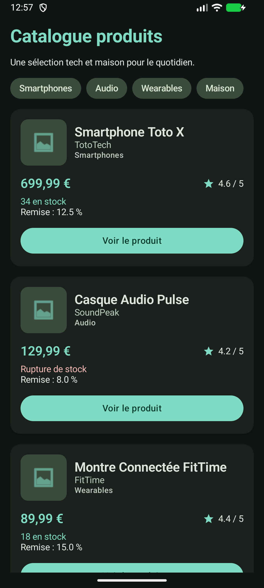

# Product Explorer

Application Android réalisée avec Jetpack Compose pour les TP 4 à 7.
Les cinq produits sont des exemples fictifs, écrits directement en Kotlin. Il n'y a pas de récupération sur Internet.

Au lancement, l'application affiche le catalogue du TP 7. L'accueil du TP 5 et le détail du TP 4 restent dans le projet et se consultent avec leurs previews.
Les boutons transmettent un callback au parent ; la navigation et les actions métier seront ajoutées dans les prochains TP.

## TP 4 : détail d'un produit

`ProductDetailScreen` assemble plusieurs petits composants :

- `ProductImage` : image placeholder locale et description d'accessibilité.
- `ProductHeader` : nom, marque et catégorie.
- `ProductPriceCard` : prix et remise dans une `Card`.
- `ProductRating` : note accompagnée d'une `Icon` étoile.
- `ProductAvailabilityCard` : stock et livraison.
- `ProductDescription` : description du produit.
- `ProductWarrantyField` : `OutlinedTextField` en lecture seule pour la garantie.
- `AddToCartButton` : action « Ajouter au panier » avec un callback.

Deux previews permettent de comparer un produit en stock et un produit en rupture.
La bibliothèque `material-icons-extended` est déclarée dans le catalogue de versions puis utilisée dans les dépendances du module `app`.

## TP 5 : accueil

`ProductHomeScreen` utilise une `Column` pour empiler les sections et des `Spacer` pour les séparer.
Il contient un en-tête, une barre de recherche visuelle, un produit mis en avant, une ligne prix/note/stock, des catégories et une offre du jour.

`ProductQuickInfoRow` utilise `Row` et `weight(1f)` pour répartir les trois informations.
`DailyOfferBox` utilise une `Box` pour placer le badge « Nouveau » en haut à droite du bloc.
La recherche de cet accueil est seulement visuelle à ce stade.

## TP 6 : catalogue local

`ProductUi` possède un identifiant `id`. `sampleProducts()` fournit une `List<ProductUi>`.

Le catalogue utilise une seule `LazyColumn` :

- `item` ajoute le titre, la description et les catégories ;
- `items(products, key = { product -> product.id })` affiche les cartes avec une identité stable ;
- `ProductListItem` affiche un produit et transmet son clic au parent.

`CategoryRow` est une `LazyRow` qui réutilise `CategoryChip`. Les catégories sont visuelles et ne filtrent pas encore les produits.

## TP 7 : thème Material Design 3

Deux palettes vert/turquoise sont définies avec `lightColorScheme` et `darkColorScheme`.
`isSystemInDarkTheme()` permet de suivre le réglage du téléphone.

Les composants utilisent les rôles de `MaterialTheme.colorScheme`, par exemple `surface` pour les cartes et `onSurface` pour leur texte.
Les catégories associent `secondaryContainer` et `onSecondaryContainer` pour rester lisibles dans les deux thèmes.

`ProductTypography` règle quelques tailles et graisses de texte. `ProductShapes` centralise les arrondis, utilisés avec `MaterialTheme.shapes`.
Les previews `ProductCatalogScreenLightPreview` et `ProductCatalogScreenDarkPreview` montrent le même catalogue dans les deux thèmes.

## Petites personnalisations

- Prix en euros avec une virgule et deux décimales grâce à `formatPrice`.
- Une lampe de bureau ajoutée à la catégorie « Maison ».
- Une illustration placeholder dans chaque carte, la remise et un libellé de stock explicite.
- Bouton d'ajout au panier désactivé pour un produit en rupture.
- Accueil et détail défilants pour atteindre le bas du contenu sur un petit écran.
- Espace réservé au badge de l'offre pour qu'il ne recouvre pas son titre.

## Organisation du code

Tous les fichiers restent dans le package `com.example.productexplorer` :

- `MainActivity.kt` appelle l'écran catalogue dans un `Scaffold`.
- `ProductData.kt` contient le modèle et les exemples de produits.
- `ProductDetailScreen.kt` contient le détail et ses composants.
- `ProductHomeScreen.kt` contient l'accueil et les catégories réutilisables.
- `ProductCatalogScreen.kt` contient la liste et ses cartes.
- `ui/theme` contient les couleurs, les formes et la typographie.

## Ouvrir le projet

Ouvrir le dossier `ProductExplorer` dans Android Studio, attendre la synchronisation Gradle, puis lancer la configuration `app` sur un émulateur ou un téléphone.
Pour voir les écrans précédents, ouvrir le fichier correspondant en mode Split puis utiliser Build & Refresh.
Le mode interactif des previews permet de faire défiler les écrans.

## Captures

