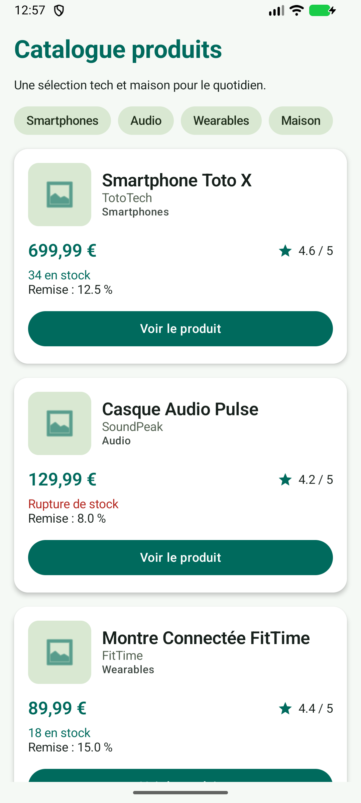
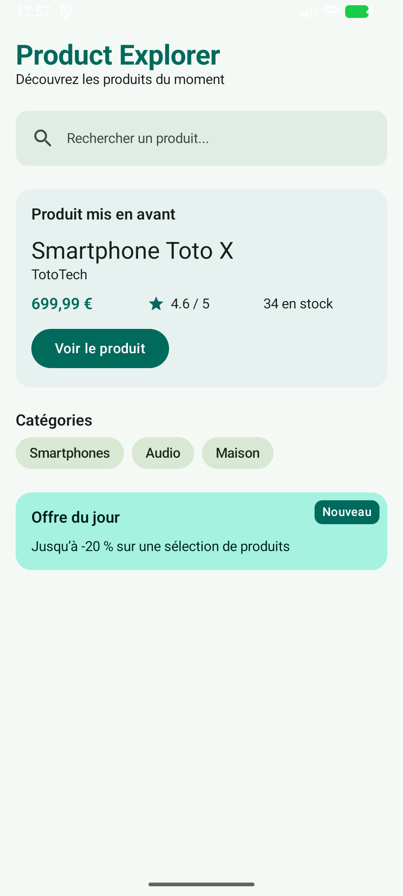
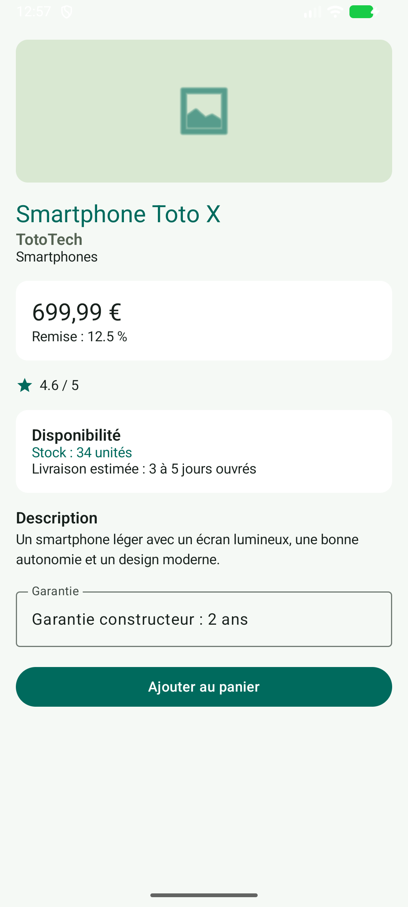

# Product Explorer

Application Android réalisée avec Jetpack Compose pour les TP 4 à 9.
Les cinq produits sont des exemples fictifs, écrits directement en Kotlin. Il n'y a pas de récupération sur Internet.

Au lancement, l'application affiche le catalogue interactif réorganisé avec le State Hoisting du TP 9. L'accueil du TP 5 et le détail du TP 4 restent dans le projet et se consultent avec leurs previews.
La navigation vers le détail et la gestion du panier seront ajoutées dans les prochains TP.

## TP 4 : détail d'un produit

`ProductDetailScreen` assemble plusieurs petits composants :

- `ProductImage` : image placeholder locale et description d'accessibilité.
- `ProductHeader` : nom, marque et catégorie.
- `ProductPriceCard` : prix et remise dans une `Card`.
- `ProductRating` : note accompagnée d'une `Icon` étoile.
- `ProductAvailabilityCard` : stock et livraison.
- `ProductDescription` : description du produit.
- `ProductWarrantyField` : `OutlinedTextField` en lecture seule pour la garantie.
- `AddToCartButton` : action « Ajouter au panier » avec un callback.

Deux previews permettent de comparer un produit en stock et un produit en rupture.
La bibliothèque `material-icons-extended` est déclarée dans le catalogue de versions puis utilisée dans les dépendances du module `app`.

## TP 5 : accueil

`ProductHomeScreen` utilise une `Column` pour empiler les sections et des `Spacer` pour les séparer.
Il contient un en-tête, une barre de recherche visuelle, un produit mis en avant, une ligne prix/note/stock, des catégories et une offre du jour.

`ProductQuickInfoRow` utilise `Row` et `weight(1f)` pour répartir les trois informations.
`DailyOfferBox` utilise une `Box` pour placer le badge « Nouveau » en haut à droite du bloc.
La recherche de cet accueil est seulement visuelle à ce stade.

## TP 6 : catalogue local

`ProductUi` possède un identifiant `id`. `sampleProducts()` fournit une `List<ProductUi>`.

Le catalogue utilise une seule `LazyColumn` :

- `item` ajoute le titre, la description et les catégories ;
- `items(products, key = { product -> product.id })` affiche les cartes avec une identité stable ;
- `ProductListItem` affiche un produit et transmet son clic au parent.

`CategoryRow` est une `LazyRow` qui réutilise `CategoryChip`. Les catégories sont visuelles et ne filtrent pas encore les produits.

## TP 7 : thème Material Design 3

Deux palettes vert/turquoise sont définies avec `lightColorScheme` et `darkColorScheme`.
`isSystemInDarkTheme()` permet de suivre le réglage du téléphone.

Les composants utilisent les rôles de `MaterialTheme.colorScheme`, par exemple `surface` pour les cartes et `onSurface` pour leur texte.
Les catégories associent `secondaryContainer` et `onSecondaryContainer` pour rester lisibles dans les deux thèmes.

`ProductTypography` règle quelques tailles et graisses de texte. `ProductShapes` centralise les arrondis, utilisés avec `MaterialTheme.shapes`.
Les previews montrent le même catalogue dans les deux thèmes. Depuis le TP 9, elles appellent `ProductCatalogContainer` et portent les noms `ProductCatalogContainerLightPreview` et `ProductCatalogContainerDarkPreview`.

## Petites personnalisations

- Prix en euros avec une virgule et deux décimales grâce à `formatPrice`.
- Une lampe de bureau ajoutée à la catégorie « Maison ».
- Une illustration placeholder dans chaque carte, la remise et un libellé de stock explicite.
- Bouton d'ajout au panier désactivé pour un produit en rupture.
- Accueil et détail défilants pour atteindre le bas du contenu sur un petit écran.
- Espace réservé au badge de l'offre pour qu'il ne recouvre pas son titre.

## Organisation du code

Tous les fichiers restent dans le package `com.example.productexplorer` :

- `MainActivity.kt` fournit les produits et catégories au conteneur dans un `Scaffold`.
- `ProductData.kt` contient le modèle et les exemples de produits.
- `ProductDetailScreen.kt` contient le détail et ses composants.
- `ProductHomeScreen.kt` contient l'accueil et les catégories réutilisables.
- `ProductCatalogContainer.kt` possède les états et la logique de filtrage.
- `ProductCatalogScreen.kt` affiche la liste et ses cartes à partir des paramètres reçus.
- `ui/theme` contient les couleurs, les formes et la typographie.

## Ouvrir le projet

Ouvrir le dossier `ProductExplorer` dans Android Studio, attendre la synchronisation Gradle, puis lancer la configuration `app` sur un émulateur ou un téléphone.
Pour voir les écrans précédents, ouvrir le fichier correspondant en mode Split puis utiliser Build & Refresh.
Le mode interactif des previews permet de faire défiler les écrans.

## Captures

## TP 8 : catalogue interactif

### Étape 1 : recherche locale

Le catalogue propose un champ `OutlinedTextField` pour chercher dans le nom, la marque ou la catégorie, sans tenir compte des majuscules.

- `mutableStateOf` crée l'état du texte saisi.
- `rememberSaveable` conserve ce texte lors d'une recréation de l'écran, par exemple une rotation.
- `remember(products, searchQuery)` recalcule la liste filtrée quand ses dépendances changent.
- La `LazyColumn` affiche maintenant `filteredProducts`.

Une recherche vide affiche tous les produits. Si aucun produit ne correspond, un message invite à essayer un autre mot.
Les captures ci-dessus correspondent à la fin du TP 7.

### Étape 2 : stock et nombre de résultats

Un bouton permet d'afficher uniquement les produits dont le stock est supérieur à zéro, puis de revenir à tous les produits.
`showOnlyInStock` est un booléen conservé avec `rememberSaveable`. Le clic inverse sa valeur avec `!showOnlyInStock`.

Le calcul de `filteredProducts` dépend maintenant aussi de ce booléen. Un produit doit correspondre à la recherche **et** au filtre de stock pour être affiché.
Le compteur utilise directement `filteredProducts.size`, sans créer un état supplémentaire.
Quand le filtre est actif et qu'il n'y a aucun résultat, le message propose aussi de désactiver le filtre.

### Étape 3 : favoris locaux

Chaque carte propose un bouton « Ajouter aux favoris » ou « Retirer des favoris », accompagné d'un cœur vide ou plein.
`favoriteProductIds` garde les identifiants des produits favoris dans une liste avec `rememberSaveable`.
La fonction `toggleFavorite` crée une nouvelle liste en ajoutant ou en retirant l'identifiant du produit.

L'état reste dans `ProductCatalogScreen` pour ce TP. `ProductListItem` reçoit seulement `isFavorite` et `onFavoriteClick` : la carte affiche la valeur reçue et transmet le clic à son parent.
Un produit reste favori lorsqu'il est masqué puis réaffiché par la recherche ou le filtre de stock. Les favoris sont aussi conservés après une rotation, mais ne sont pas enregistrés durablement dans une base de données.

Le TP 8 apporte la recherche, le filtre de stock, le compteur et les favoris. Le TP 9 ci-dessous réorganise la gestion de ces états avec le State Hoisting.

## TP 9 : State Hoisting

### Étape 1 : remonter les états dans un parent

`ProductCatalogContainer` est le composable **stateful** : il conserve `searchQuery`, `showOnlyInStock` et `favoriteProductIds` avec `rememberSaveable`. Il contient aussi le calcul de la liste filtrée et `toggleFavorite`.

`ProductCatalogScreen` devient **stateless** : il reçoit la liste déjà filtrée, les catégories, les valeurs à afficher et les callbacks. Il ne contient plus les états du TP 8 ni le calcul du filtre.

Par exemple, quand on écrit dans la recherche :

1. Le champ appelle `onSearchQueryChange` avec le nouveau texte.
2. Le conteneur modifie `searchQuery` et recalcule la liste.
3. L'écran reçoit les nouvelles valeurs et les affiche.

Les données descendent, les événements remontent. `ProductListItem` continue de recevoir `isFavorite` et `onFavoriteClick`, sans gérer lui-même la liste des favoris.

`MainActivity` appelle maintenant le conteneur avec les données locales. Les deux previews clair/sombre appellent aussi ce conteneur pour conserver les interactions.

### Étape 2 : prévisualiser l'écran stateless

Deux previews supplémentaires, dans `ProductCatalogScreen.kt`, appellent directement `ProductCatalogScreen` avec des valeurs fixes :

- `ProductCatalogScreenStatelessPreview` : recherche « Toto », un smartphone déjà favori et une seule catégorie.
- `ProductCatalogScreenEmptyPreview` : recherche « casque », filtre de stock actif et liste vide en thème sombre.

L'écran n'a pas besoin de connaître l'origine de ces valeurs pour les afficher. Les catégories viennent aussi des paramètres : chaque preview peut donc fournir sa propre liste.

Dans ces deux exemples, les callbacks sont vides (`{}`) : la saisie et les clics ne changent pas les valeurs affichées. Pour tester les interactions, utiliser les previews `ProductCatalogContainerLightPreview` / `ProductCatalogContainerDarkPreview` en mode interactif, ou lancer l'application avec ▶.

Le TP 9 est terminé : le conteneur possède les états, l'écran et les cartes affichent les données et transmettent les événements. La recherche, le filtre et les favoris gardent le comportement du TP 8.
